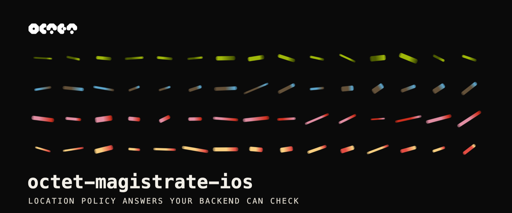

<p align="center">
  <a href="https://octetproof.com">
    
  </a>
</p>

<div align="center">

**Ask a location policy question in your iOS app, and get a signed answer your backend can check.**

[](https://github.com/octetproof/octet-magistrate-ios/releases) [](#install) [](https://octetproof.com/docs/magistrate/) [](LICENSE) [](https://github.com/octetproof/octet-magistrate-ios)

[](https://octetproof.com) [](https://octetproof.com/docs/magistrate/) [](https://magistrate.octetproof.com)

</div>

> [!IMPORTANT]
> **Octet proves; you decide.** Octet gives you the tools to define a location policy
> and a signed proof of where a device was. Magistrate returns your policy's answer
> with a signed receipt. It does not block, allow or change anything in your app or on
> your servers. Your backend verifies the receipt and decides what happens to the
> request. If your backend ignores the answer, nothing is enforced.

## What it is

Many apps have to know where a user is before they allow something: a payment from a
sanctioned country, a game in a jurisdiction where it isn't licensed, content outside
its rights region. A GPS reading or an IP address is easy to fake, and a yes/no that
your app reports is only as trustworthy as the device it runs on.

Magistrate answers a location policy question, such as *"Is the device in a country
under embargo?"*, with **YES**, **NO** or **UNKNOWN**, backed by evidence instead of a
claim:

- **An attested location proof.** OctetSDK produces the proof on the device and signs
  in with App Attest, so the answer comes from a genuine install of your app.
- **A signed policy.** The policy bundle is verified on the device before it is used,
  and a bundle that doesn't verify is never used.
- **A signed receipt.** Every answer comes with a receipt that your backend checks with
  Octet's published keys, so you act on the receipt, not on what the app reports.
- **Fail-closed.** Without a current proof the answer is UNKNOWN, with a cause such as
  "no location fix yet", never a guess.
- **One call.** You write the policy in the [Magistrate Studio](https://magistrate.octetproof.com)
  and call `decide` in your app.

## Write a policy and try it

<p align="center">
  
</p>

1. **Open the Studio** at [magistrate.octetproof.com](https://magistrate.octetproof.com).
2. **Build.** Say what you need in plain words, for example *"Allow checkout only in
   the EU and the UK"*, or use the builder and the map. The Studio turns it into a
   policy question and the places it names.
3. **Review.** Read the policy in plain English and approve each line. Approving every
   line lets you sign it off.
4. **Ship.** Sign off the policy and hand it to Octet. Once Octet has reviewed it and
   linked it to your licence, `decide` in your app uses it.
   Until then, `decide` throws `PolicyError.notProvisioned`.
5. **Ask in your app.** Install Magistrate and call `decide` ([quick start](#quick-start)).
6. **Decide on your server.** Your backend checks the receipt and acts on YES, NO or
   UNKNOWN ([reading the answer](#reading-the-answer)).

## Install

Add two packages with Swift Package Manager: Magistrate, and OctetSDK for
`Octet.start`. Magistrate depends on the same OctetSDK version internally, but SwiftPM
doesn't re-export it, so your app declares it too, pinned to the matching version:

```swift
.package(url: "https://github.com/octetproof/octet-magistrate-ios", exact: "0.1.0"),
.package(url: "https://github.com/octetproof/octet-sdk-ios", exact: "3.1.2"),
```

Add the `Magistrate` and `OctetSDK` products to your target. Requires iOS 16.

## Quick start

```swift
import OctetSDK    // Octet.start(...)
import Magistrate  // Magistrate(sdk:).decide(...)

// 1. Start OctetSDK. It signs in with App Attest, so there's no licence key.
let sdk = try await Octet.start(
    config: OctetConfig(),
    startPosition: nil
)
guard let license = sdk.licenseStatus else { return }  // activation didn't complete

// 2. One call: fetch + verify the policy, prove the location it needs, get the answer.
let result = try await Magistrate(sdk: sdk).decide(license: license)

// 3. Send the receipt to your backend. It verifies the receipt and decides.
try await myBackend.submit(receipt: result.receipt, decisionRef: result.decisionRef)
```

`decide` returns a `DecisionResult` (`decision`, `isPermit`, `obligations`, `reasons`,
`policyVersion`, `proofRoot`, `decisionRef`, `receipt`). A NO is a returned result, not
a thrown error; failures throw a typed `PolicyError`. `myBackend` stands for your own
API.

> [!TIP]
> A minimal app is in [`sample/`](sample/). [`INTEGRATION.md`](INTEGRATION.md) has the
> full API, the receipt checks for your server, obligations, error handling and
> cross-launch bundle caching.

## How it works

```text
  1. Magistrate Studio           2. your app                       3. Octet
  magistrate.octetproof.com
 ┌─────────────────────┐ signed ┌─────────────────────────┐ proof   ┌──────────────────────┐
 │ you write it; Octet │ policy │ Magistrate verifies the │ ──────► │ checks the proof     │
 │ reviews, signs it   │ ─────► │ policy; OctetSDK proves │         │ against the policy,  │
 └─────────────────────┘        │ where the device is     │ ◄────── │ signs the answer     │
                                └────────────┬────────────┘ receipt └──────────────────────┘
                                             │ receipt
                                             ▼
                                ┌─────────────────────────┐
                                │ 4. your backend checks  │
                                │ the receipt, then       │
                                │ decides: allow, block … │
                                └─────────────────────────┘
```

Magistrate asks OctetSDK to prove only what the policy needs (for example, the
country), so the device sends a proof, not a GPS trace.

## Reading the answer

| Answer | When | In the receipt | What your backend might do |
|---|---|---|---|
| **YES** | There's a current proof, and the device is in the area the policy question names. | `decision` equals the question's `yes_is`, no `cause` | Your rule for YES: allow, or block, depending on the question |
| **NO** | There's a current proof, and the device is outside that area. | `decision` differs from `yes_is`, no `cause` | Your rule for NO |
| **UNKNOWN** | There's no current proof, so the question can't be answered. | `cause` is set, for example `absence` (no location fix yet) or `stale` | Ask again, step up, or refuse. Don't read it as YES or NO. |

Whether YES is good news depends on the question, so map each answer to your own action
per policy.

> [!WARNING]
> **Check the receipt on your server, not the result in the app.** The app's copy of
> `decision` is only as trustworthy as the device. Your backend checks the receipt's
> signature with Octet's published keys, its expiry, your licence and your
> `decision_ref`, then reads the answer from the receipt. The steps are in
> [`INTEGRATION.md`](INTEGRATION.md#verifying-the-receipt-on-your-server).

## Verifying the download

The Swift Package's `binaryTarget` pins the `xcframework` by checksum, so SwiftPM
refuses a zip that differs from the one released. Each release also attaches
`SHASUMS256.txt`, its Sigstore bundle `SHASUMS256.txt.sigstore.json`, a CycloneDX SBOM
and the third-party notices.

This repository's `sign-release.yml` workflow signs `SHASUMS256.txt` with
[Sigstore](https://www.sigstore.dev/) keyless signing when a release is published, so
the signing certificate names that workflow and the exact release tag. To check a
release yourself, download its assets into one directory and run
([cosign](https://docs.sigstore.dev/cosign/system_config/installation/) 2.x):

```sh
V=0.1.0
IDENTITY="https://github.com/octetproof/octet-magistrate-ios/.github/workflows/sign-release.yml@refs/tags/$V"
cosign verify-blob --bundle SHASUMS256.txt.sigstore.json \
  --certificate-identity "$IDENTITY" \
  --certificate-oidc-issuer https://token.actions.githubusercontent.com \
  SHASUMS256.txt                 # must print "Verified OK"
shasum -a 256 -c SHASUMS256.txt  # every file must print "OK"
```

A signature from any other workflow, repository or tag fails the `cosign` step.

## Documentation

- [Magistrate docs](https://octetproof.com/docs/magistrate/): concepts, policies and
  the backend checks.
- [`INTEGRATION.md`](INTEGRATION.md): the full iOS API.
- [`CHANGELOG.md`](CHANGELOG.md): changes that affect your integration.
- [octet-magistrate-android](https://github.com/octetproof/octet-magistrate-android):
  the Android library.

## About this repository

This repository holds the Magistrate Swift Package (`Package.swift`, `Sources/`), the
release files (under Releases), a sample app and the documentation. Each release is one
commit, tagged with its version. Bug reports and questions are welcome as issues.

## Security

Report a vulnerability privately to security@octetproof.com, not in an issue. See
[SECURITY.md](SECURITY.md).

## License

See [LICENSE](LICENSE).
